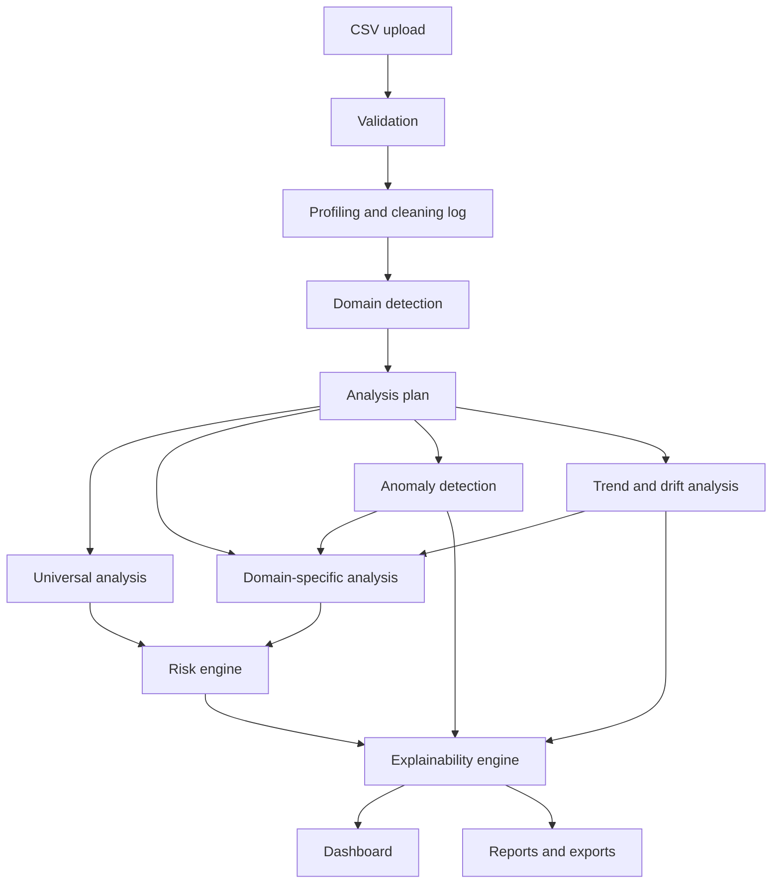
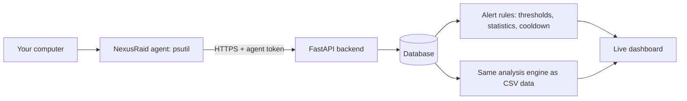
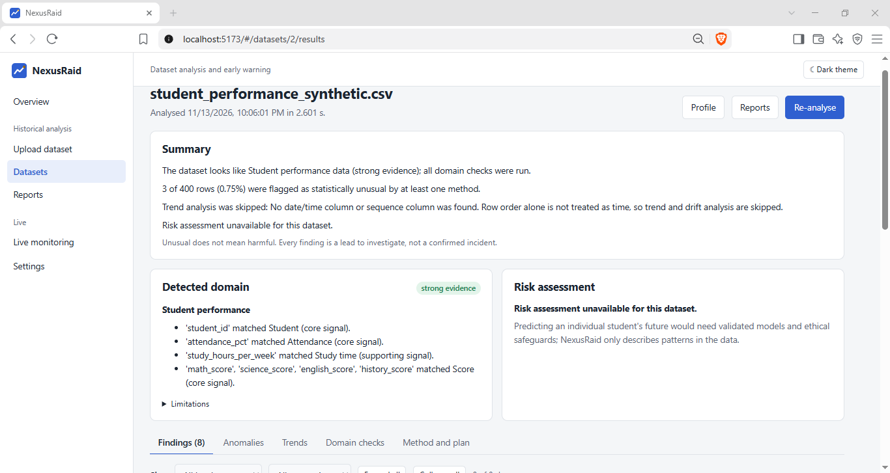
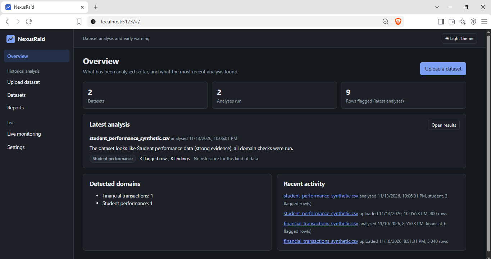
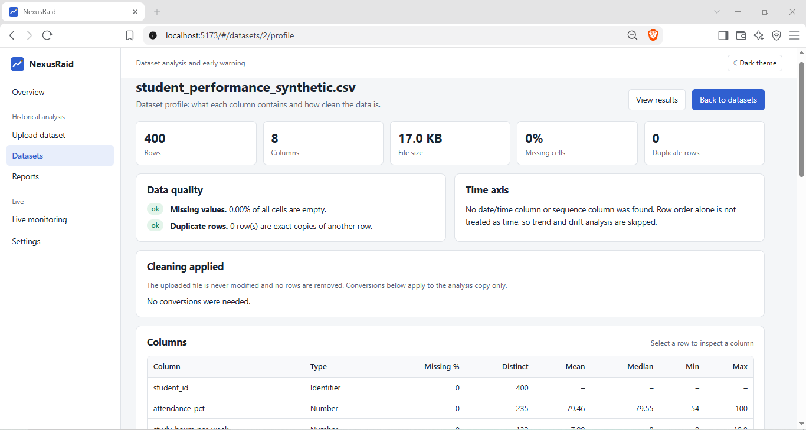

# NexusRaid

**An intelligent dataset analysis and early-warning platform.**

NexusRaid profiles CSV datasets, recognises what kind of data they contain,
finds unusual values, trends and sudden changes, and explains every finding in
plain language. A lightweight agent adds live monitoring of real computers.
All analysis runs locally with statistics and classical machine learning: no
paid API, no GPU, no internet connection needed after installation.

---

## 1. Overview

Organisations collect more data than anyone can watch. Problems rarely start
with a dramatic failure: memory creeps up, response times stretch, a sensor
drifts, errors appear a few at a time. NexusRaid is built to surface those
early, quiet signals and to say clearly **what** was found, **why** it was
flagged, **how sure** the system is and **what to check next**.

Who it is for: students and analysts exploring datasets, developers and
system administrators reviewing metrics, and anyone who needs an explainable
first look at unfamiliar data.

**What NexusRaid will not do:** call an anomaly a failure, attack or fraud, or
present a risk score as a probability. An unusual observation, a statistically
significant pattern, a possible risk indicator and a confirmed incident are
different things, and the interface keeps them apart.

## 2. Problem statement

* Large volumes of data, but no time to inspect them manually.
* Unusual patterns hide in many columns at once.
* Degradation is gradual, so fixed thresholds miss it.
* Fixed thresholds ("alert when CPU > 90%") stay silent while CPU, memory,
  latency and errors all rise together but each stays below its line.
* Tools that do flag problems rarely explain them, so people either ignore the
  alerts or trust them blindly.

| Time | CPU | RAM | Response time |
|---|---|---|---|
| 10:00 | 35% | 45% | 100 ms |
| 10:20 | 52% | 59% | 240 ms |
| 10:40 | 76% | 79% | 650 ms |

No single reading crosses a 90% alarm, yet the combined trend shows growing stress.

## 3. Objectives

1. Accept and safely validate CSV uploads.
2. Profile every column and explain all cleaning.
3. Estimate the data's domain from evidence, without forcing unknown data into a category.
4. Choose analysis methods that suit each column and record why.
5. Detect unusual values, unusual rows, trends, drift, spikes, level shifts and gaps.
6. Assess risk only where it can be defended, and show exactly how.
7. Explain every finding; offer reports and exports.
8. Monitor real machines through an explicitly installed agent.
9. Run on modest hardware locally and be deployable online.

## 4. Status of features

| Feature | Status |
|---|---|
| CSV upload, validation, profiling, cleaning log | Implemented |
| Domain detection (server, website, network, IoT, financial, student, general) | Implemented |
| Per-column and row-level anomaly detection | Implemented |
| Trend, drift, spike, level-shift and gap analysis | Implemented |
| Rule-based risk assessment (server, website, IoT) | Implemented |
| Explainability engine, HTML report, CSV/JSON exports | Implemented |
| Dashboard with light/dark theme, mobile layout | Implemented |
| Live monitoring agent, alerts, cooldown, heartbeat | Implemented |
| Multi-signal co-movement | Implemented (co-occurrence only, no causal claims) |
| LOF and DBSCAN row-level detection | Experimental (optional, size-limited) |
| PDF reports | Not implemented: print the HTML report to PDF from the browser |
| Failure-propagation analysis, what-if simulation, predictive models | Planned |
| Multiple user accounts | Not implemented: one shared workspace, optionally protected by an access key |

## 5. Key features

**Historical CSV analysis.** Drag-and-drop upload with progress, server-side checks of
extension, size, binary content, encoding (UTF-8, UTF-16, Windows-1252),
delimiter, header, duplicate column names, malformed rows and size limits.

**Automatic profiling.** Column types (number, date/time, category, yes/no,
identifier, text, constant, empty), missing values, duplicates, statistics,
histograms, top values and a Spearman correlation matrix. Text such as `45%` or
`1,234` is converted to numbers, and every conversion is listed. The uploaded file
is never modified and no rows are removed.

**Domain detection.** Evidence level (strong, partial or none), matched columns, reasons,
alternatives considered and limitations.

**Anomaly detection.** Modified Z-score, Z-score, IQR (also on a log scale), Isolation
Forest, LOF and DBSCAN, chosen per column and dataset. Every flagged row has a reason.
Identifier and outcome/label columns are never used as inputs.

**Trends over time.** Kendall trend test, linear slope, drift from baseline, spikes,
persistent level changes, missing intervals, per-device series for sensor
data, and bucketed counts for event data.

**Explainability.** Every finding answers: what happened, which columns, observed value,
normal range, why flagged, which method, what it could indicate, how confident,
what information is missing and what to investigate next.

**Risk assessment.** Transparent 0–3 signal scores, configurable thresholds, weights and
cut-offs. For other kinds of data it shows: *"Risk assessment unavailable for this dataset."*

**Dashboard.** Overview, upload, datasets, profile with column inspector, results,
Anomaly Explorer, reports, live monitoring and settings, in light and dark themes.

**Live monitoring.** psutil-based agent (CPU, memory, disk, disk I/O, network I/O,
processes), token authentication, buffering while offline, threshold and
statistical alerts with cooldown, and "No recent data" detection.

## 6. How it works



1. **Validate** the file before anything is stored (bad files are deleted immediately).
2. **Profile** each column and convert text that is really numbers or dates, logging each change.
3. **Detect the domain** from column names and types.
4. **Plan**: decide which columns are numeric inputs, and record why the others are excluded.
5. **Detect anomalies** per column and per row.
6. **Analyse trends** if, and only if, a real time column exists.
7. **Run analyzers**: universal checks always, plus the domain's checks.
8. **Assess risk** where supported.
9. **Explain**: every result becomes a finding with the same ten answers.

Live monitoring:



## 7. Supported domains

| Domain | Recognised from columns such as | Domain checks |
|---|---|---|
| Server monitoring | cpu, memory/ram, disk, response time, errors | sustained high utilisation, impossible percentages, disk-growth projection, risk |
| Website performance | requests, latency/p95, errors, status | latency percentiles, error rate, latency vs traffic, risk |
| Network traffic | src/dst, port, protocol, bytes, packets | top talkers, bursts per source, protocol/port mix (no attack labelling) |
| IoT sensors | device/sensor, temperature, humidity, pressure, battery | stuck sensors, per-device gaps, drift, plausible ranges, sensor-health risk |
| Financial transactions | amount, transaction, account, merchant | amount outliers (log scale), bursts per account, category and channel mix (no fraud labelling) |
| Student performance | student, scores/subjects, attendance | impossible scores, subject relationships, inconsistent records (no individual predictions) |

**Partially recognised** datasets run only the checks their columns support.
**Unknown** datasets get universal analysis: statistics, missing data,
duplicates, outliers, correlations and differences between groups.

## 8. Technology stack

| Technology | Purpose |
|---|---|
| Python 3.11+ | Backend and analysis |
| FastAPI, Uvicorn | REST API and web server; automatic API docs at `/docs` |
| Pydantic, pydantic-settings | Request validation and configuration from environment variables |
| SQLAlchemy | Database layer: SQLite locally, PostgreSQL in production without code changes |
| pandas, NumPy | Data loading and processing |
| SciPy | Kendall trend test, Kruskal-Wallis test |
| scikit-learn | Isolation Forest, LOF, DBSCAN |
| React 18, Vite | Dashboard and development server/build tool |
| Recharts | Charts |
| psutil | System metrics in the monitoring agent |
| pytest | Automated tests |

## 9. Project architecture

```
nexusraid/
├── backend/
│   ├── app/
│   │   ├── main.py                # app factory, CORS, security headers, optional frontend serving
│   │   ├── api/routes/            # health, system, datasets, analysis, reports, monitoring
│   │   ├── core/                  # config, errors, security (access key, agent token)
│   │   ├── database/              # connection, models, repository (all queries)
│   │   ├── schemas/               # request/response validation
│   │   ├── services/              # validation, profiling, domain detection, anomaly detection,
│   │   │                          # trends, risk, explanation, reports, pipeline, monitoring
│   │   ├── analyzers/             # universal + 6 domain analyzers, shared checks, registry
│   │   └── utils/
│   ├── tests/                     # pytest suite
│   ├── requirements.txt
│   └── .env.example
├── frontend/
│   ├── src/ (components, pages, hooks, services, styles, utils)
│   ├── package.json
│   └── .env.example
├── monitoring_agent/              # agent.py, collector.py, sender.py, agent_config.py, tests
├── samples/                       # synthetic datasets + generator (clearly labelled synthetic)
├── docs/ALGORITHMS.md             # every method explained, with dry runs
├── LICENSE
└── README.md
```

Design decisions:

* **The analysis engine does not depend on the web framework.** `services/` and
  `analyzers/` use only pandas, NumPy and scikit-learn. They can be tested on their own
  and are reused unchanged for live-monitoring history.
* **Adding a domain** means writing one analyzer class and adding it to `registry.py`.
* **Uploaded files stay on disk** under random server-generated names. The database
  stores metadata, profiles and results.

## 10. Installation (Windows)

Prerequisites: Python 3.11 or newer, Node.js 18 or newer (with npm), and Git.
Backend tests pass on Windows with Python 3.14; frontend dependencies install with Node.js 26.

If PowerShell blocks scripts ("running scripts is disabled on this system"), either run
`Set-ExecutionPolicy -Scope CurrentUser RemoteSigned` once, or use `npm.cmd` instead of
`npm` and call `.\.venv\Scripts\python.exe` directly instead of activating the environment.

```powershell
git clone https://github.com/Priyanshugairola-9/nexusraid.git
cd nexusraid

# Backend
cd backend
py -m venv .venv
.\.venv\Scripts\Activate.ps1
python -m pip install -r requirements.txt
copy .env.example .env

# Frontend (new terminal, from the repository root)
cd frontend
npm install
```

If PowerShell blocks `Activate.ps1`, run once:
`Set-ExecutionPolicy -Scope CurrentUser RemoteSigned`.

To enable live monitoring, put a token in `backend/.env`:

```powershell
python -c "import secrets; print(secrets.token_urlsafe(32))"
# copy the output into NEXUSRAID_AGENT_TOKEN=... in backend/.env
```

## 11. Running locally

**Terminal 1: backend**

```powershell
cd backend
.\.venv\Scripts\Activate.ps1
uvicorn app.main:app --reload
```

The API runs on http://127.0.0.1:8000 (interactive docs at http://127.0.0.1:8000/docs).
Tables and folders are created on the first start.

**Terminal 2: frontend**

```powershell
cd frontend
npm run dev
```

Open http://localhost:5173. Upload a file from `samples/` to try it.

**Terminal 3: monitoring agent (optional)**

```powershell
cd monitoring_agent
py -m venv .venv
.\.venv\Scripts\Activate.ps1
pip install -r requirements.txt
$env:NEXUSRAID_AGENT_TOKEN="<same token as in backend/.env>"
python agent.py --api-url http://127.0.0.1:8000
```

`python agent.py --dry-run --once` prints one sample without sending it.

**Single-port mode (also works from a phone on the same Wi-Fi)**

```powershell
cd frontend
npm run build
cd ..\backend
uvicorn app.main:app --host 0.0.0.0 --port 8000
```

The backend serves the built dashboard at `http://<your-computer's-IP>:8000`.
Allow the port through Windows Firewall only on trusted networks, and set
`NEXUSRAID_ACCESS_KEY` if others share the network.

## 12. Cloud deployment

The frontend and backend are separate and can be hosted separately.

| Part | Suitable hosts | Notes |
|---|---|---|
| Frontend (static files from `npm run build`) | Netlify, Vercel, any static host | Set `VITE_API_BASE_URL` to the backend URL before building. Hash-based URLs need no rewrite rules. |
| Backend (FastAPI) | Render, Railway, PythonAnywhere, a VPS, AWS | Must run a Python web process. Netlify/Vercel static hosting **cannot** run it. |
| Database | PostgreSQL (managed) | Set `NEXUSRAID_DATABASE_URL`; install `psycopg[binary]`. |
| Uploaded files | Persistent disk or volume | Many free tiers wipe the disk on restart: uploads and a SQLite file would disappear. |
| Monitoring agent | Your own machines | Point `--api-url` to the deployed backend. Use HTTPS. |

Backend start command on most platforms:
`uvicorn app.main:app --host 0.0.0.0 --port $PORT` (working directory `backend`).

Production checklist:

* `NEXUSRAID_ENVIRONMENT=production`
* `NEXUSRAID_ACCESS_KEY` set to a long random value (the app logs a warning without it)
* `NEXUSRAID_CORS_ORIGINS` set to your frontend's exact URL
* `NEXUSRAID_DATABASE_URL` pointing to PostgreSQL. SQLite is for a single local instance only.
* Persistent storage for `NEXUSRAID_UPLOAD_DIR`, or a retention period with
  `NEXUSRAID_DATASET_RETENTION_DAYS`
* Health check path: `/api/v1/health`
* Before long-term use with PostgreSQL, add Alembic migrations (tables are currently
  created automatically but never altered).

Free-tier limits change often. Check each platform's current documentation for
memory limits, sleeping instances and disk persistence.

## 13. Dashboard

Real screenshots of NexusRaid running locally with the synthetic samples.
More are in [docs/screenshots](docs/screenshots/README.md).

| Analysis results (light) | Overview (dark) |
|---|---|
|  |  |



## 14. Example workflows

**A server metrics file** (`samples/server_metrics_synthetic.csv`):

1. Upload: the file passes validation (864 rows, 7 columns).
2. Profiling turns `timestamp` text into dates and finds a regular 5-minute interval.
3. Domain: *Server monitoring, strong evidence* (CPU, memory and disk columns), with website performance noted as an alternative.
4. Plan: 6 numeric columns are used; `timestamp` is the time axis.
5. Findings include 5 isolated CPU spikes, rising CPU, memory, response time and
   errors (*"5 signals changed together"*, without claiming which causes which),
   steady disk growth with a straight-line projection marked low confidence,
   and *Operational stress: High*, with every contributing signal listed.
6. Download the HTML report from Reports.

**An unknown dataset** (`samples/general_unknown_synthetic.csv`, plant measurements):

1. No domain matches, so it is classed as a *General dataset* and nothing is forced into a category.
2. Universal analysis finds the 4 unusually tall plants and the strong
   sunlight–height relationship.
3. Trends are skipped: there is no time column, and row order is not treated as time.
4. Risk: *"Risk assessment unavailable for this dataset."*

## 15. Testing

```powershell
cd backend
.\.venv\Scripts\Activate.ps1
pytest
```

92 tests pass on Windows (Python 3.14). The full run takes a few minutes on a dual-core laptop.

Tests cover valid and invalid uploads (empty, binary, wrong type, encodings,
malformed rows, duplicate headers, size and row limits), profiling, domain
detection for all seven samples and unknown or partial data, anomaly detection
(including a check that clean data is not over-flagged), trends, risk, reports
(HTML escaping, CSV formula injection), monitoring rules, the full API flow,
access-key protection, CORS and monitoring ingestion.

```powershell
cd monitoring_agent
pip install pytest
python -m pytest tests
```

The agent tests use a local fake backend to check buffering while offline,
recovery, wrong tokens and invalid data.

Sample datasets are synthetic and listed with their injected patterns in
`samples/generate_samples.py`. Regenerate them with `python samples/generate_samples.py`.

## 16. Limitations

* **Domain detection** reads column names and types. Misleading or cryptic names
  (`c1`, `val`) lead to "general" or a wrong domain.
* **False positives.** Statistical thresholds flag some normal values by chance,
  especially in very large files. Confidence levels mark findings where this is likely.
* **Data quality matters.** Wrong units, mixed sources or mislabelled columns produce misleading results.
* **Historical data describes the past.** Trends are not forecasts. The disk
  projection is a labelled straight-line extrapolation.
* **No validated prediction.** Predicting failures needs labelled incident history
  and time-based validation; NexusRaid does not claim predictive accuracy.
* **Risk thresholds are defaults,** not calibrated against real incidents.
* **Co-movement is not causation.**
* **Live monitoring** needs the agent to be installed and started. It cannot measure
  application response times or error counts, which need instrumentation inside the
  application.
* **Security:** input validation, an optional shared access key, an agent token,
  security headers and CSV-injection protection. There are no user accounts, no
  rate limiting and no audit log, so this is not production-grade security.
* **Performance:** analysis runs inside the request. 200,000 rows takes seconds on a
  modern CPU and longer on low-end laptops.

### Known issues

* `recharts` 2.x is no longer maintained; migrating to Recharts 3 is planned.
* `npm audit` reports vulnerabilities in development dependencies; they are being reviewed.
  Do not run `npm audit fix --force`, which can install breaking major versions.
* npm 11 may skip esbuild's install script. If `npm run dev` fails with an esbuild error,
  run `npm install-scripts approve esbuild` and `npm rebuild esbuild`.
* The test run shows a Starlette deprecation warning about the test client; it does not
  affect the application.

## 17. Future scope

* Failure-propagation analysis across dependent components
* What-if simulation of metric changes
* Validated predictive models where labelled incident data exists
  (precision, recall and F1 with time-based splits)
* More domain analyzers (energy, manufacturing, logistics)
* Notifications for alerts (email/webhook) and alert grouping
* Background job queue for very large files
* User accounts and per-user datasets
* Alembic migrations

## 18. Contributing

1. Fork the repository and create a branch.
2. Keep the analysis engine free of web-framework imports.
3. Add tests for new behaviour (`pytest` must pass).
4. Follow PEP 8 and use descriptive names.
5. Open a pull request explaining what changed and why.

To add a domain, subclass `BaseAnalyzer` in `backend/app/analyzers/`, define its
roles and `analyze()`, register it in `registry.py`, and add a synthetic sample and tests.

## 19. License

MIT. See [LICENSE](LICENSE).

## 20. Author and AI assistance

Developed by **Priyanshu Gairola**.

AI tools were used as development assistants for technical research,
brainstorming, architectural discussion, code explanations, debugging
assistance and implementation support. Project direction, development
decisions, integration, testing and final responsibility remain with the author.

## 21. Disclaimer

* Anomaly detection identifies statistically unusual data. It does not prove that an
  incident, error, attack or fraud occurred.
* Risk levels are rule-based indicators, not guarantees or probabilities.
* Results depend on the quality of the input data.
* NexusRaid supports investigation; it does not replace expert judgement.
* Privacy: uploaded files are stored on the server running NexusRaid until deleted
  (or until the configured retention period ends) and are not sent to third
  parties. Do not upload data you are not permitted to share.
