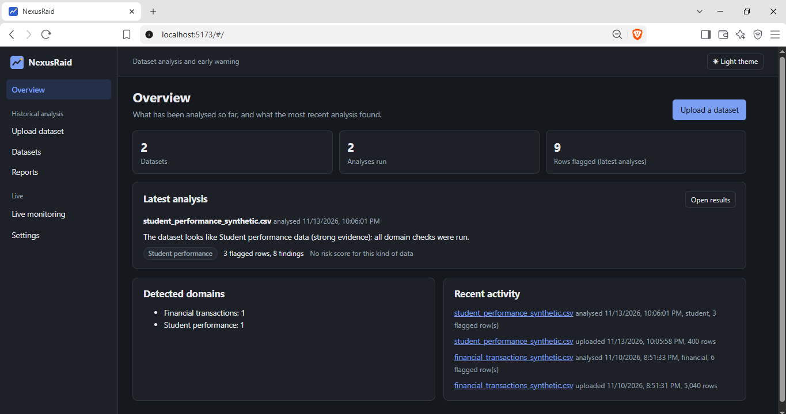
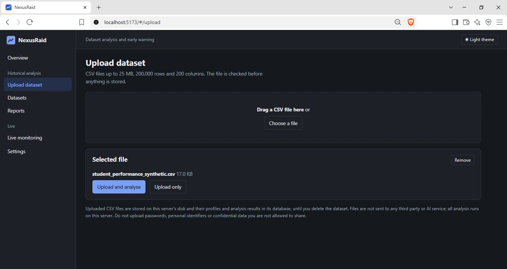
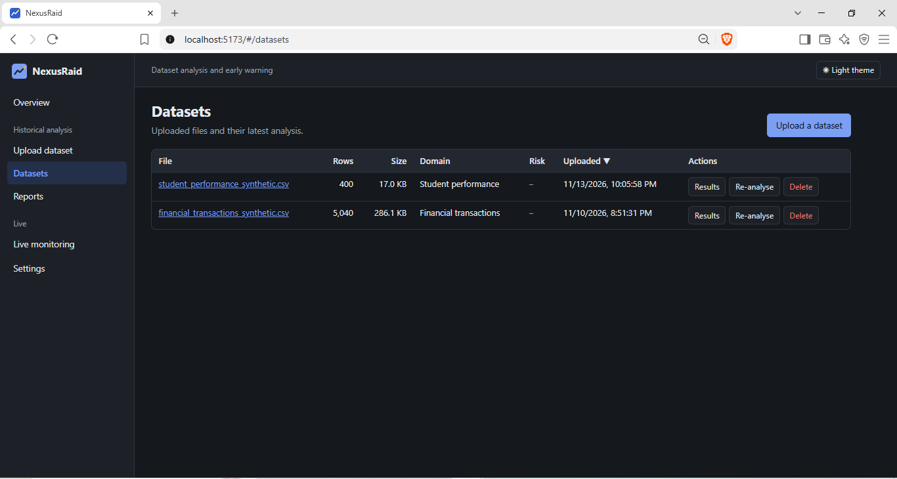
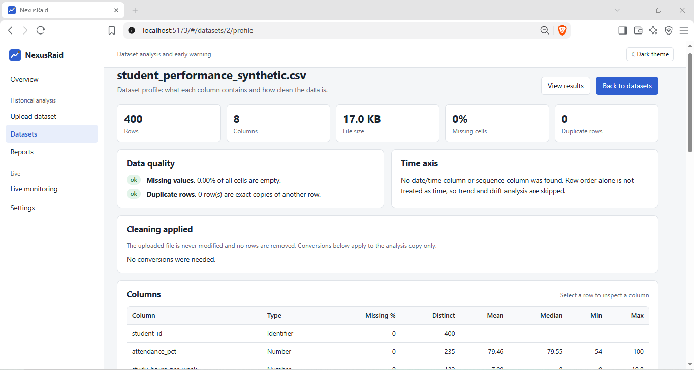
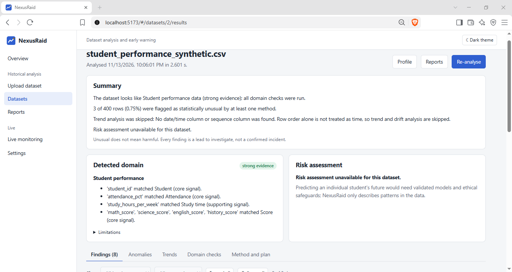
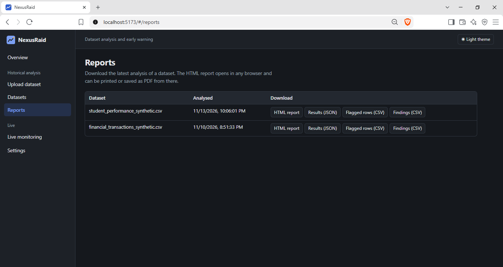
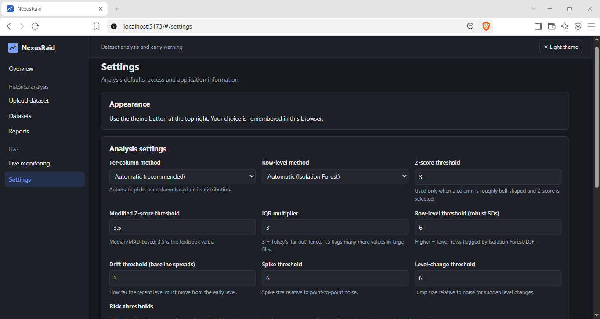

# NexusRaid screenshots

Screenshots of NexusRaid running locally on Windows (Brave browser), using the
synthetic sample datasets from `samples/`. Both light and dark themes are shown.

## Overview (dark theme)
Counts of datasets and analyses, the latest analysis and recent activity.

## Upload dataset (dark theme)
Drag-and-drop or file picker, with limits and the privacy notice.

## Datasets (dark theme)
Uploaded files with their detected domain and actions.

## Dataset profile (light theme)
Size, data quality, time-axis detection, cleaning log and column types for
`student_performance_synthetic.csv`.

## Analysis results (light theme)
Summary, detected domain with evidence, and why no risk score is given for
student data.

## Reports (dark theme)
HTML report, JSON results and CSV exports.

## Settings (dark theme)
Analysis methods and thresholds.

